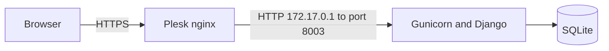

# Mediator

Mediator lets two parties check whether a deal is possible without revealing their reserve prices.

One person enters a bid or an ask. The other person receives a separate code and enters their own number. The app answers only "negotiation is possible" or "negotiation is not possible". A bid is the most a buyer will pay. An ask is the least a seller will accept. A deal is possible when the bid is greater than or equal to the ask.

## Usage

Open `/mediate/` and choose **Start**.

1. Choose Bid or Ask and enter the reserve price.
2. Set how many days the other party has to respond (2–14) and how many days the result stays available after both sides have answered (2–14).
3. Submit. The confirmation page shows two codes. Save both. There is no account and no way to recover them.
4. Keep **your code**. Send **your partner's code**, or the QR image, to the other party.
5. The partner opens that link, enters their reserve price, and both of you can open your own code to see the result.

Each side can submit once. Changing the number later does not change the result, and the two prices are deleted as soon as the result is known. If the partner does not answer in time, the offer is deleted. After the display window, the result is deleted too.

Check a code again from **Check**, or open `/mediate/check/<code>`.

## Architecture

HTTPS stops at the reverse proxy. Gunicorn speaks HTTP on port 8003. In production that proxy is Plesk's nginx, connected with a Docker proxy rule.



Django is mounted at `/mediate/`. The pages are `start`, `check`, and `process`. Static files are served by WhiteNoise. The container entrypoint runs migrations and `collectstatic`, then starts one Gunicorn worker. One worker matches SQLite, which cannot take concurrent writes from several workers.

The database file is `/data/mediate/db.sqlite3` inside the container. That directory is the image volume, so the file survives a new container. Locally, outside Docker, the file is `db.sqlite3` in the project directory.

A negotiation is one row with two random codes, `bid_id` and `ask_id`. The row's own primary key is never shown. The first party sees both codes. The partner receives only one. While waiting for the second price, the first price is stored. When the second price arrives, the app stores the yes/no result, clears both amounts, and records `completed_at`. Access logs omit the request path so the codes are not written there.

## Local development

```sh
python -m venv .venv
source .venv/bin/activate
pip install -r requirements.txt

export DEBUG=true
python manage.py migrate
python manage.py runserver
```

The site is at http://127.0.0.1:8000/mediate/. With `DEBUG=true`, `SECRET_KEY` and `ALLOWED_HOSTS` can stay unset. Leave `TRUSTED_PROXY_IPS` empty.

Run the tests with:

```sh
DEBUG=true python manage.py test mediate
```

## Deployment

Build and publish the image:

```sh
docker buildx build --platform=linux/amd64 -t mediator .
docker tag mediator stevwyman/mediator
docker push stevwyman/mediator
```

Run the container with the environment variables below and a volume on `/data/mediate`. In Plesk's Docker extension, map container port `8003` to `127.0.0.1` only, then add one proxy rule:

| Field | Value |
| --- | --- |
| Domain | the public site |
| Path | `/` |
| Container port | `8003` |

The path stays `/`. Django already serves the app under `/mediate/`.

`TRUSTED_PROXY_IPS` is the address Gunicorn sees for nginx. With a Plesk proxy rule that is the Docker bridge gateway, usually `172.17.0.1`, not the container's own address.

## Configuration

| Variable | Required | Purpose |
| --- | --- | --- |
| `SECRET_KEY` | when `DEBUG` is false | Django secret. A key starting with `django-insecure` is refused in production. |
| `DEBUG` | no | `true` for local HTTP. Defaults to false. |
| `ALLOWED_HOSTS` | when `DEBUG` is false | Comma-separated public host names. |
| `CSRF_TRUSTED_ORIGINS` | behind HTTPS | Comma-separated origins, such as `https://example.com`. |
| `TRUSTED_PROXY_IPS` | behind a TLS proxy | Comma-separated addresses allowed to set `X-Forwarded-Proto` and `X-Forwarded-Host`. The proxy must overwrite both headers itself. |

With `DEBUG` false and no trusted proxy, Django redirects HTTP to HTTPS forever, because Gunicorn only sees HTTP.
